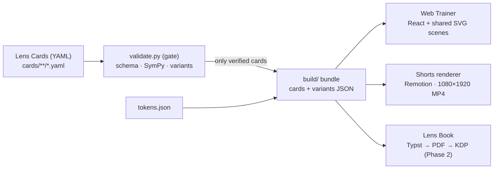
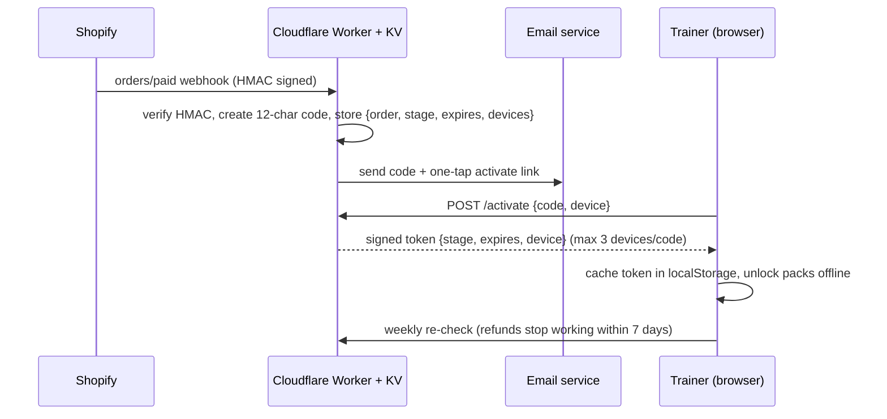
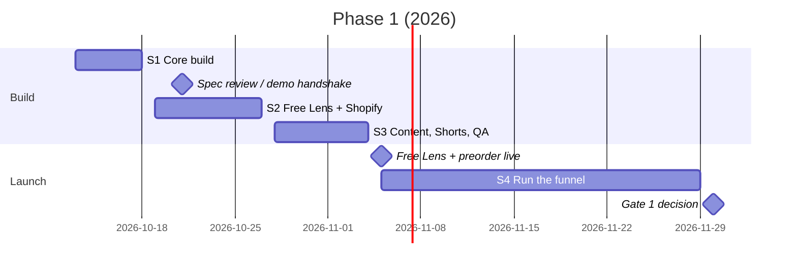

# 視点レンズ (The Lens) — Phase 1 PRD & Architecture Spec

Version 1.0 · Oct 12, 2026 · Owner: Product Architect · Live copy: [claude.ai doc](https://claude.ai/code/artifact/03f9b4fd-c111-431c-8219-e01e765b8d8e)

This file is the Builder's onboarding spec. The repo is the source of truth for code and cards; changes to this spec go through a PR reviewed by the Product Architect.

## 1. Summary

The schema, the validator and the 3 Enclose reference cards are built and pass every check. Phase 1 ships the Free Lens demo and a ¥6,800 early-bird preorder on **Nov 5**, and Gate 1 is decided on **Nov 30** (30 paid families + 300 signups).

| File | What it is | Status |
| --- | --- | --- |
| `schema/lens-card.schema.json` | Lens Card schema v1.0 (JSON Schema 2020-12) | Done |
| `tools/validate.py` | Schema + SymPy checks + variant generator | Done; rejects a wrong answer in testing |
| `cards/enclose/enclose-001.yaml` | Standard card, 19.5 cm² | Verified + 3 variants |
| `cards/enclose/enclose-f01.yaml` | Failure card, 26 cm² | Verified + 3 variants |
| `cards/enclose/enclose-no-lens.yaml` | No-lens control, 17.5 cm² | Verified + 3 variants |
| `tokens/tokens.json` | Visual tokens for web, video and print | Done |
| `.github/workflows/validate-cards.yml` | Runs the validator on every push and PR | Done |

**Locked architecture decisions**

1. **No access engine in Phase 1.** The preorder sells a promise, not access; Shopify alone handles Gate 1. The access Worker is built Dec 1–14, only if Gate 1 passes.
2. **One renderer.** The trainer and the Shorts share the same React SVG scene components; Remotion renders Shorts from them. Python is used only for validation and variant generation.
3. **Free Lens needs only an email**, captured as a Shopify customer with marketing consent. No child data.
4. **Print is grayscale-first.** Trap vs lens is carried by line weight and dash, never by hue alone.

**Roles**

| Role | Owns |
| --- | --- |
| Product Architect (Claude) | Schema evolution, validation standards, card authoring and math review, this spec, code review of PRs |
| Builder | Remotion components, Web Trainer / Free Lens front end, pipeline scripts; merges PRs once approved |
| Coordinator | Sprint sync, Shopify preorder and email setup, milestone tracking |
| Founder (Brian) | Approves every PR before merge, publishes Shorts, outside reviewer, test children |

## 2. Core technical architecture

Every surface reads one build bundle, and nothing reaches the bundle without passing the validator, so the trainer, a Short and a book page can never show different math.



| Layer | Technology | Runs where | Phase |
| --- | --- | --- | --- |
| Content | YAML cards, `tokens.json` | This repo | 1 |
| Gate | Python 3.12, SymPy, jsonschema | GitHub Actions on every push / PR | 1 |
| Shared scenes | React components drawing SVG from a card + tokens | `packages/scenes` (proposed) | 1 |
| Web Trainer | Vite + React static site | Cloudflare Pages | 1 (Free Lens) |
| Shorts | Remotion renders the same scenes to MP4 | Local or CI, on demand | 1 |
| Book | Typst template reads bundle JSON + tokens | Local build | 2 |
| Access | One Cloudflare Worker + KV | Cloudflare | 2 |
| Commerce | Shopify (cards + PayPal), Shopify Email | Existing store | 1 |

**Proposed repo layout for the Builder** (a pnpm workspace):

```
apps/trainer      Vite + React Free Lens / trainer
apps/shorts       Remotion project
packages/scenes   <LensScene card step tokens /> and per-figure renderers
packages/tokens   tokens.json → CSS variables + TS constants (generated)
cards/ schema/ tokens/ tools/   content and validation (exists)
```

**Scene contract.** A scene is a pure function of (card, step, tokens): `<LensScene card={card} step={n} />`. The trainer drives `step` from the child's taps; Remotion drives it from the frame number. Same component, so the animation a child sees is the one in the Short. Scenes never compute math; they draw values that come from the validated card or variant.

Remotion is free for for-profit companies with up to 3 employees ([licence](https://github.com/remotion-dev/remotion/blob/main/LICENSE.md)). Re-check if headcount grows.

## 3. Access and session flow

**Phase 1 (Nov 5 – Nov 30): no access engine.**

1. Parent enters an email on the Free Lens page → Shopify customer with marketing consent.
2. Trainer stores progress and timings in `localStorage` only.
3. Preorder is a normal Shopify product: inventory 30, ¥6,800, delivery month in the description, refund terms on the page.

**Phase 2 engine (Dec 1 – Dec 14, only if Gate 1 passes)**



- Codes use 12 characters with no 0/O/1/I. "Lost code?" posts the parent's email to `/resend`. No passwords.
- `localStorage` holds the token, per-card attempts and timings, streak and settings. Every read/write is wrapped in try/catch; the trainer works in private mode without saved progress. An Export button saves progress as a file.
- Trade-off: a code works on 3 devices and card content is public in the bundle. The lock protects convenience, not secrecy; acceptable for a ¥9,800 family product.

## 4. Web Trainer interaction specs

One problem screen and one parent report carry the whole Free Lens. Tablet-first, 48 px tap targets, no typing.

**Perspective Picker (per card)**

1. Problem appears with the figure only; a quiet timer starts. A 「解いてみる」 scratch area lets the child try first.
2. Child taps one of the 4 `picker.options` (order shuffled per attempt).
3. Child taps the clue they noticed from `trigger.tags`. A right lens with a wrong clue earns a hint, not full credit.
4. **Right pick:** overlay plays (`animation.keyframes`), then `lens_route.steps` appear one by one with values.
5. **Wrong pick:** that option's `feedback_ja` shows, the option greys out, child picks again. After 2 misses the `trigger.ja` sentence appears as a hint.
6. A variant follows immediately, timed, no help. That timing feeds the report.

**Time-Saved report (end of Free Lens)**

- Compares the first attempt with the timed variant; always says "same-type problem" (同じ型の問題), never "same problem".
- Shows the 目安 / 実測 badge from `time_source`. No claims about exam scores.
- Ends with one next step (the failure card) and the preorder button.

**Overlay animation layer**

- Separate SVG layer above the figure, driven by `animation.keyframes` and `tokens.motion` durations.
- Lens-coloured strokes at lens weight; the trap figure dims to trap ink beneath it.
- `prefers-reduced-motion`: end states fade in over 200 ms. Replay button; scrubber in the parent view.

**Mixed set (Phase 2):** 10 items, all 8 lenses plus 2 No-lens items, scored on pick + clue, not on the numeric answer.

## 5. Lens Card engineering spec

A card is publishable only when `tools/validate.py` passes it. Status flow: `draft` → `verified` (validator) → `reviewed` (outside math + Japanese review) → `published`. Renderers read `verified` or later; Shorts and the book require `reviewed`.

| Field | Purpose | Rule |
| --- | --- | --- |
| `id`, `kind`, `lens`, `best_move` | Identity; `kind` = standard / failure / no_lens | `best_move` required unless standard |
| `provenance` | Originality record | `original: true` is a constant; `built_from` names the archetype |
| `grounding` | Theorem behind the lens, JA + EN | Shown as one line in trainer and book |
| `problem.figure` | Lattice points, counter-clockwise, grid size | Integers only, inside the grid |
| `answer.value` | Exact answer as a SymPy string (`39/2`) | Must equal the computed area |
| `trap_route`, `lens_route` | Steps with `value` and `op` (start/add/sub/result/note) | Step arithmetic must equal the answer |
| `trigger` | Sentence + tags used as picker clues | ≥ 1 tag |
| `fails_when` | Link to the failure card | Standard cards only |
| `picker` | 4 options, the correct one, one feedback line each | `correct` must be an option |
| `checks` | Validator assertions to run | ≥ 1 |
| `variants` | Generator, count, fixed seed | Same seed = same variants every build |

**Validator checks (exact arithmetic):** `area_equals_answer` (shoelace and SymPy `Polygon.area`), `route_steps_sum`, `enclose_clean`, `enclose_not_clean`, `has_horizontal_base`, `simple_polygon`, `lattice_only`, `lens_faster`.

**Variant generators**

| Generator | Construction | Guarantee |
| --- | --- | --- |
| `enclose_standard` | Box 4–8; one vertex strictly inside each side | Convex; every gap a right triangle |
| `enclose_tilted_square` | Side vector (b, a), a ≠ b, a + b in 4–8 | A true square (`tilted_square` check), four congruent corners |
| `enclose_triangle` | One vertex on a box corner, one on the left side, one on the top | No side on a grid line; three right-triangle gaps |
| `enclose_failure_notch` | Box 5–8; notch of two inside vertices, the deeper one at x = m | Enclose stalls; a cut at x = m leaves pieces with grid-line bases |
| `no_lens_flat_base` | Base on a grid line; apex strictly above the base | Base × height ÷ 2 wins |

Each variant re-runs its parent's structural checks (so it matches the card's wording and still needs the same move), and carries its own `lens_route.steps`. A variant is dropped unless those steps sum exactly to its own answer. Generators assume `cell_cm = 1`.

**Bundle contract (what the Builder imports).** `python3 tools/validate.py cards/**/*.yaml --bundle` writes `build/bundle.json` only if every card passes:

```jsonc
{
  "bundle_version": "1.2",
  "schema_version": "1.1",
  "tokens": { /* tokens/tokens.json, verbatim */ },
  "labels": { "lenses": { "enclose": { "ja": "囲む", "hint_ja": "…" }, … },   // labels/lenses.yaml
              "tags":   { "vertices_on_box": { "ja": "…" }, "grid": { "ja": "…", "generic": true }, … } },  // labels/tags.yaml
  "cards": [            // status verified or later, sorted by lens then id
    { /* every Lens Card field, as in the YAML */,
      "variants": [
        { "id": "enclose-001-v1", "points": [[1,0],[4,4],[1,5],[0,4]],
          "grid": {"width": 4, "height": 5, "cell_cm": 1}, "answer": "10",
          "lens_route": { "steps": [ {"ja": "…", "value": "20", "op": "start"}, … ] } } ] } ]
}
```

**Step details (bundle 1.1).** For standard Enclose cards and their variants, the bundle adds a verified `detail` to the box step (`{kind: "box", width, height}`) and to each corner step (`{kind: "corner", n, edge, corner: [x, y], base, height}`). Scenes draw base/height marks and formula cards from these numbers only; the validator guarantees `base × height ÷ 2` equals the step value.

**Labels (bundle 1.2).** All Japanese UI words that belong to content live in `labels/` and ship in `bundle.labels`: lens button names (`labels/lenses.yaml`) and clue-chip texts (`labels/tags.yaml`). Each card's `picker.clue_distractors` lists 2–3 decoy clues. The validator fails a card if any option or chip lacks a label, if a decoy is also a real clue, or if the card has no specific (non-generic) clue.

**Step order is part of the contract.** Scenes put each piece's label on the piece by the order of the steps. For standard Enclose cards, the `sub` steps list the corner gaps in edge order starting at edge AB (A→B, B→C, …). For notch failure cards, the `start`/`add` steps are: right rectangle, bottom triangle, side triangle, top triangle. The validator's `step_order` check enforces both, so a card whose labels would land on the wrong piece cannot reach the bundle.

Numbers in `answer` and step `value` are exact SymPy strings (`"39/2"`); display them with `display_ja` or format the fraction, never re-compute. The front end treats the bundle as read-only and never does math.

**Golden reference cards**

| Card | Figure | Answer | Lesson | Lens route |
| --- | --- | --- | --- | --- |
| `enclose-001` | Tilted quadrilateral, one vertex per side of a 6×6 box | 19.5 cm² | Enclose collapses it | 36 − (1.5 + 5 + 4 + 6) |
| `enclose-002` | Tilted square, side vector (5, 2), in a 7×7 box | 29 cm² | Don't measure a slanted side | 49 − 4 × 5 |
| `enclose-003` | Triangle with no side on a grid line, in a 6×5 box | 14 cm² | Don't hunt for a base | 30 − (3 + 5 + 8) |
| `enclose-f01` | Hexagon with a two-vertex notch | 26 cm² | Gap isn't a right triangle; cut at x = 3 | 18 + 3 + 2 + 3 |
| `enclose-no-lens` | Triangle, base 7, height 5 | 17.5 cm² | Enclose works but is the long way | 7 × 5 ÷ 2 |

All `time_cost_sec` values are `estimate` until replaced by medians from 5–10 test children. SymPy proves correctness, not originality; originality rests on `provenance` and archetype-first authoring.

## 6. Cross-media visual tokens

`tokens/tokens.json` is the only place a colour, line weight, font or timing is defined.

| Group | Decision | Print fallback |
| --- | --- | --- |
| Trap | One muted ink, dashed 1.0 line, Klee One hand font | 60% black, dashed |
| Lens | One accent per lens, solid 2.5 (heaviest line on any page) | 100% black 2.5 + lens icon |
| Construction | Box / cut / axis: dashed 1.5 in lens colour | 100% black, dashed |
| Flags | Time-cost and stall markers | Black + glyph, never red alone |
| Type | Noto Sans JP, Inter (numbers), Klee One (scratchwork); all SIL OFL | Same |
| Time strip | Bar 6 high, 4 s/mm, always with 目安/実測 badge | Same |
| Layout | Trainer max 1080 px, 48 px taps; Shorts 1080×1920 with safe zones | — |
| Motion | 600 ms line draw, 400 ms shade; reduced-motion fallback | — |

## 7. Phase 1 sprint plan



| Workstream | Task | Sprint | Owner | Done when |
| --- | --- | --- | --- | --- |
| Repo | Initial commit, CI validation workflow, `/docs` | S1 | Architect | ✅ Done |
| Repo | Branch protection on `main`: require the "Validate Lens Cards" check | S1 | Founder | Failing card blocks merge |
| Content | enclose-002, enclose-003 standard cards | S1 | Architect | ✅ PR open |
| Content | Step generators for all variants; `build/bundle.json` | S1 | Architect | ✅ PR open |
| Frontend | pnpm workspace; Vite + React scaffold; tokens → CSS variables | S1 | Builder | Deploys to Cloudflare Pages |
| Frontend | `LensScene` for grid polygons with Enclose keyframes | S1 | Builder | enclose-001 animates end to end |
| Frontend | Picker, clue step, feedback, hints | S2 | Builder | All 3 reference cards playable |
| Frontend | Time-Saved report; safe `localStorage` wrapper; Export | S2 | Builder | Works in private mode |
| Frontend | Japanese landing page: problem → Free Lens → preorder | S2 | Builder (copy: Architect, approval: Founder) | Reviewed on iPad and phone |
| Commerce | Preorder product: ¥6,800, inventory 30, delivery month, refund terms, Vendor 視点レンズ | S2 | Coordinator | Test order placed and refunded |
| Commerce | Email signup → Shopify customers; welcome + 3-mail sequence | S2 | Coordinator | Test signup gets mail 1 |
| Video | Remotion project importing `LensScene`; 30 s Short template | S2 | Builder | enclose-001 renders to MP4 |
| Content | One standard card for each of the other 7 lenses | S2–S3 | Architect | 7 cards verified |
| Content | Outside math + Japanese review of all Phase 1 cards | S3 | Founder books reviewer | Status `reviewed` |
| Content | Time 5–10 children on Enclose cards | S3 | Founder | Medians replace estimates |
| Video | Render 8 Shorts, Japanese captions | S3 | Builder renders, Founder publishes | 8 MP4s approved |
| Ops | Cookie-free analytics + tracking tag per Short | S3 | Builder | Signups traceable to a Short |
| Ops | 2 Shorts/week; weekly funnel review | S4 | Coordinator | 4 reviews done |
| Serverless | Access Worker, codes, email delivery | Dec 1–14 | Builder | Only if Gate 1 passes |

**Review rule for PRs:** any change to `schema/`, `tools/` or `cards/` needs the Product Architect's review and a green validation check. Front-end PRs need a green check and a screen recording of the change on a tablet-sized viewport.

## 8. Gate 1 verification checklist

Gate 1 passes on Nov 30 if ≥ 30 families have paid ¥6,800 **and** ≥ 300 have signed up for the Free Lens. Weekly pace: ~75 signups and ~8 preorders. A week under half pace triggers a change to the Short hook or landing page that week.

**Launch readiness (Nov 4)**

- [ ] All Phase 1 cards `reviewed` (validator + outside reviewer).
- [ ] Free Lens plays end to end on iPad Safari, an Android tablet and a phone.
- [ ] Trainer works in a private window without errors.
- [ ] Email signup creates a Shopify customer with consent; welcome mail arrives.
- [ ] Preorder page: price, January 2027 delivery month, contents, full refund if delivery slips past Jan 31.
- [ ] 特定商取引法 page covers preorder delivery timing and refunds.
- [ ] Test order placed and refunded.
- [ ] ≥ 4 Shorts rendered and scheduled, each with its own tracking tag.
- [ ] Analytics: visits, Free Lens starts, completions, signups, preorder clicks.
- [ ] Privacy note: progress stays on the device; no child data collected.

**Gate 1 decision (Nov 30)**

- [ ] Paid preorders: ___ / 30
- [ ] Free Lens signups: ___ / 300
- [ ] Completion rate (started → report shown): ___
- [ ] Preorders ÷ signups: ___ (planning assumption 10%)
- [ ] Best and worst Short by signups
- [ ] Decision: **go** to Phase 2 · **fix** the funnel for 2 more weeks · **stop** and refund all preorders

## 9. Risks and open questions

| Risk | Mitigation |
| --- | --- |
| 7 non-Enclose cards slip | Only 4 Shorts needed at launch; the rest follow weekly |
| Outside reviewer not found in time | Book this week; cards stay `verified`, Shorts wait for `reviewed` |
| Amazon.co.jp prints interiors black-only | Grayscale-first tokens; confirm in KDP setup before Phase 2 |
| Preorder delivery slips past Jan 31 | Full-refund promise; access engine is one small Worker |
| Time-saved claims overstate | "Same-type problem" wording + 目安/実測 badge |

- [ ] Trainer domain (subdomain of beyondculture.ai?)
- [ ] Outside math and Japanese reviewer
- [ ] Early-bird delivery month: January 2027?
- [ ] KDP trim and ink options for Amazon.co.jp
